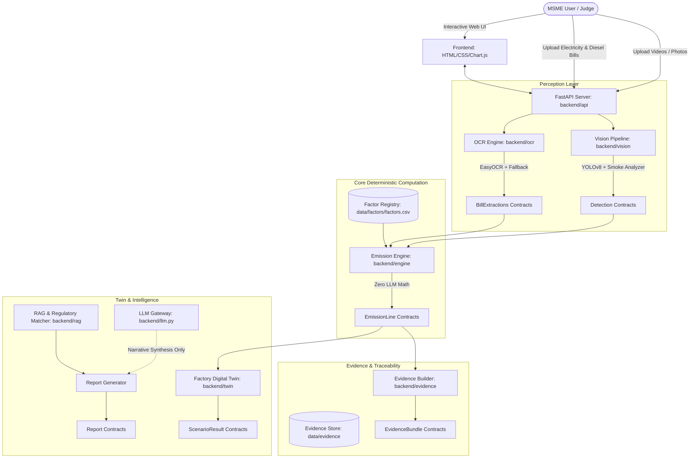

# Carbon Passport System Specification (SPEC.md)

## 1. Problem & Target Users

### Target Audience
Micro, Small, and Medium Enterprises (MSMEs), suppliers, and export manufacturers in emerging markets (particularly India and Southeast Asia) facing stringent supply chain sustainability disclosures (e.g., CBAM, BRSR, Scope 3 supplier queries) without dedicated sustainability staff or five-figure consulting budgets.

### The Problem
Traditional carbon accounting tools require manually categorizing hundreds of entries, guessing load factors, and calculating arbitrary numbers with zero traceability. Exporters risk penalties or rejection from European and North American buyers if numbers lack audit trails.

### The Solution: Carbon Passport
An MVP that extracts machinery data from mobile videos and photos (YOLO machine detection, OCR nameplate recognition, optical smoke analysis) and operational data from utility bills (OCR + deterministic parsing). It computes Scope 1, Scope 2, and initial Scope 3 emissions strictly via an auditable, deterministic factor engine. Every single displayed number links back directly to a cryptographic hash, timestamped video frame, or scanned invoice snippet.

---

## 2. Architecture & Module Diagram



---

## 3. Global Rules & Invariants (from AGENTS.md)

1. **Emission numbers come ONLY from backend/engine and data/factors/factors.csv.** No LLM may create, change or round a number.
2. **Never hardcode an emission factor, price or tariff in code.** Never invent values. Unknown values are the literal string `TODO_VERIFY` and the code must refuse to run on them.
3. **Every EmissionLine has at least one `evidence_ref`.**
4. **Smoke analysis never changes CO2e directly.** It only widens the low/high range and raises a maintenance flag.
5. **Results are estimates with low/high ranges.** Never claim certification or regulatory compliance. Say the output 'supports the data these frameworks request'.
6. **Secrets come only from environment variables (.env).** Never print, log, echo or commit them.
7. **All Gemini calls go through backend/llm.py** (timeout, retry with backoff, JSON validation, SHA-256 file cache in data/cache/, MOCK_LLM and DEMO_OFFLINE switches).
8. **Follow backend/schemas.py.** Change a schema only by updating SPEC.md and every caller in the same change.
9. **Write tests with every module.** Run pytest before saying you are done and fix failures yourself.
10. **Small focused commits.** Do not edit outside your assigned module without saying so.

---

## 4. The Six Schemas & Example Payloads

### 4.1 Detection
```json
{
  "id": "det_dg_001",
  "source_file": "genset_run_test.mp4",
  "frame_index": 142,
  "frame_path": "data/evidence/frames/genset_run_test_142.jpg",
  "machine_type": "diesel_generator",
  "fuel_type": "diesel",
  "rated_power_kw": 125.0,
  "rated_kva": 156.25,
  "nameplate_text": "KIRLOSKAR GREEN 125 kW DIESEL GENSET 415V",
  "smoke": {
    "level": "heavy",
    "color": "black",
    "score_0_10": 8.4
  },
  "maintenance_flag": true,
  "confidence_0_1": 0.94,
  "bbox": {
    "x_min": 120.0,
    "y_min": 85.0,
    "x_max": 540.0,
    "y_max": 720.0
  }
}
```

### 4.2 BillExtraction
```json
{
  "id": "bill_elec_2024_03",
  "source_file": "bescom_bill_march.pdf",
  "bill_type": "electricity",
  "period_start": "2024-03-01",
  "period_end": "2024-03-31",
  "quantity": 18450.0,
  "unit": "kWh",
  "amount_inr": 156825.0,
  "supplier": "BESCOM Karnataka",
  "confidence_0_1": 0.96,
  "field_boxes": {
    "units_consumed": [245, 310, 310, 335],
    "amount": [450, 310, 520, 335]
  },
  "method": "ocr",
  "user_confirmed": true
}
```

### 4.3 EmissionLine
```json
{
  "id": "em_line_scope2_grid_01",
  "scope": 2,
  "category": "Purchased Electricity (Grid)",
  "activity_value": 18450.0,
  "activity_unit": "kWh",
  "factor_id": "EF_IN_GRID_CEA_V19",
  "factor_value": 0.716,
  "factor_unit": "kgCO2e/kWh",
  "factor_source": "Central Electricity Authority (CEA) CO2 Baseline Database v19",
  "factor_url": "https://cea.nic.in/cdm-co2-baseline-database",
  "formula_text": "18450.0 kWh * 0.716 kgCO2e/kWh",
  "co2e_kg": 13210.2,
  "low_kg": 12549.69,
  "high_kg": 13870.71,
  "evidence_refs": [
    "data/bills/bescom_bill_march.pdf",
    "sha256:7c9e0d1f..."
  ],
  "method": "bill",
  "flags": []
}
```

### 4.4 ScenarioResult
```json
{
  "scenario_inputs": {
    "solar_rooftop_kw": 50.0,
    "dg_maintenance": true
  },
  "baseline_co2e_kg": 24500.0,
  "new_co2e_kg": 17800.0,
  "delta_pct": -27.35,
  "inr_saved_per_month": 48500.0,
  "capex_inr": 2200000.0,
  "payback_months": 45.36,
  "ranked_levers": [
    {
      "rank": 1,
      "lever": "Rooftop Solar PV (50 kWp)",
      "co2e_reduction_kg": 5200.0,
      "payback_months": 42.0
    },
    {
      "rank": 2,
      "lever": "Injector servicing & air filter overhaul for DG Set",
      "co2e_reduction_kg": 1500.0,
      "payback_months": 3.2
    }
  ],
  "assumptions": [
    "Average 4.5 peak sun hours per day in Southern Region",
    "Solar generation replaces grid electricity at current tariff",
    "Maintenance resolves heavy black smoke inefficiency"
  ]
}
```

### 4.5 Report
```json
{
  "sections": [
    {
      "title": "Executive Summary",
      "content_markdown": "This report provides an initial carbon footprint estimate for MSME machining operations supporting supply-chain disclosures.",
      "charts": [
        {"type": "donut", "data_ref": "scope_breakdown"}
      ]
    }
  ],
  "facts_snapshot": {
    "reporting_period": "2024-Q1",
    "grid_consumption_kwh": 18450.0,
    "diesel_consumption_litres": 420.0
  },
  "number_map": {
    "13210.2": "em_line_scope2_grid_01",
    "1125.6": "em_line_scope1_genset_01"
  },
  "validation": {
    "passed": true,
    "untraceable_numbers": []
  }
}
```

### 4.6 EvidenceBundle
```json
{
  "line_id": "em_line_scope1_genset_01",
  "audit_chain": [
    {
      "step_number": 1,
      "description": "Video frame captured at t=4.7s showing DG Genset nameplate and exhaust",
      "timestamp": "2024-03-20T10:14:32Z",
      "actor_or_component": "backend/vision/detector.py (YOLOv8)"
    },
    {
      "step_number": 2,
      "description": "Optical smoke analysis detected black smoke score 8.4; flagged maintenance",
      "timestamp": "2024-03-20T10:14:33Z",
      "actor_or_component": "backend/vision/smoke.py"
    },
    {
      "step_number": 3,
      "description": "Calculated Scope 1 diesel combustion with widened uncertainty range",
      "timestamp": "2024-03-20T10:14:35Z",
      "actor_or_component": "backend/engine/calculator.py"
    }
  ],
  "files": [
    "data/evidence/frames/genset_run_test_142.jpg",
    "data/bills/diesel_fuel_invoice_03.jpg"
  ],
  "hashes": {
    "data/evidence/frames/genset_run_test_142.jpg": "e3b0c44298fc1c149afbf4c8996fb92427ae41e4649b934ca495991b7852b855",
    "data/bills/diesel_fuel_invoice_03.jpg": "a591a6d40bf420404a011733cfb7b190d62c65bf0bcda32b57b277d9ad9f146e"
  }
}
```

---

## 5. API Endpoints

- `POST /api/upload/video` -> Upload machine/factory video; returns job ID and initial extracted frames.
- `POST /api/upload/bill` -> Upload electricity/fuel/transport invoice; returns `BillExtraction`.
- `GET /api/detections` -> List machine detections and smoke evaluations.
- `GET /api/extractions` -> List extracted bill data for user confirmation.
- `PUT /api/extractions/{id}/confirm` -> MSME user confirms or edits bill figures.
- `POST /api/calculate` -> Triggers deterministic engine computation; returns list of `EmissionLine`.
- `GET /api/evidence/{line_id}` -> Returns complete `EvidenceBundle` with file hashes and audit trail.
- `POST /api/scenarios/simulate` -> Runs digital twin what-if calculations; returns `ScenarioResult`.
- `POST /api/report/generate` -> Synthesizes traceable report document; returns `Report`.
- `GET /api/report/download/pdf` -> Downloads ReportLab generated audit-ready PDF.
- `GET /api/factors` -> Returns the verifiable factor registry from `factors.csv`.

---

## 6. Folder Ownership & Team Division

| Role | Folders Owned | Key Responsibilities |
|---|---|---|
| **Engineer A** | `backend/vision`, `backend/ocr` | Video ingestion, YOLOv8 inference, smoke opacity scoring, EasyOCR nameplate & bill parser |
| **Engineer B** | `backend/engine`, `backend/api`, `backend/evidence` | Deterministic emission engine, factor registry loader, FastAPI REST endpoints, cryptographic audit bundle |
| **Engineer C** | `backend/twin`, `frontend` | Factory what-if simulation, ROI payback models, Chart.js dashboard, evidence click-through UI |
| **Engineer D** | `backend/rag`, `data/`, `docs/`, `scripts/` | ChromaDB regulatory guidance, prompt engineering in `llm.py`, factor verification dataset, end-to-end tests |

---

## 7. Definition of Done (Phases 1 to 11)

- **Phase 1: Foundation & Contracts**: Skeleton, `.env`, schemas, `backend/llm.py` with mock/cache, passing `check_env.py`.
- **Phase 2: Factor Registry & Engine**: `factors.csv` seeded with verified sources; engine calculates lines without hardcoded values; unknown values trigger `TODO_VERIFY` error.
- **Phase 3: Bill OCR Pipeline**: Ingest PDF/images, extract quantities/tariffs with EasyOCR, fallback to Gemini via `llm.py`, bounding box metadata stored.
- **Phase 4: Vision Pipeline**: Frame extraction, machinery YOLO detection, nameplate crop, optical smoke opacity & color detection with maintenance flags.
- **Phase 5: Evidence & Audit Bundle**: Cryptographic SHA-256 hash generation for every frame/crop/bill; audit chain construction.
- **Phase 6: Digital Twin Simulation**: Solar PV, LED, equipment maintenance payback simulator; strictly deterministic math.
- **Phase 7: RAG & Regulatory Matching**: ChromaDB with BRSR, CBAM, and GHG protocol excerpts to provide context explanations for export compliance.
- **Phase 8: Report Generation**: ReportLab PDF and JSON report generation where every number is validated against `number_map`.
- **Phase 9: Frontend Web Dashboard**: Clean vanilla HTML/CSS/JS + Chart.js dashboard showing live evidence popups on number click.
- **Phase 10: Mock & Offline Demo Hardening**: Full workflow operates seamlessly with `DEMO_OFFLINE=1` and `MOCK_LLM=1`.
- **Phase 11: End-to-End Verification & Polish**: All pytest tests pass; sample videos and bills processed end-to-end under 60 seconds.
